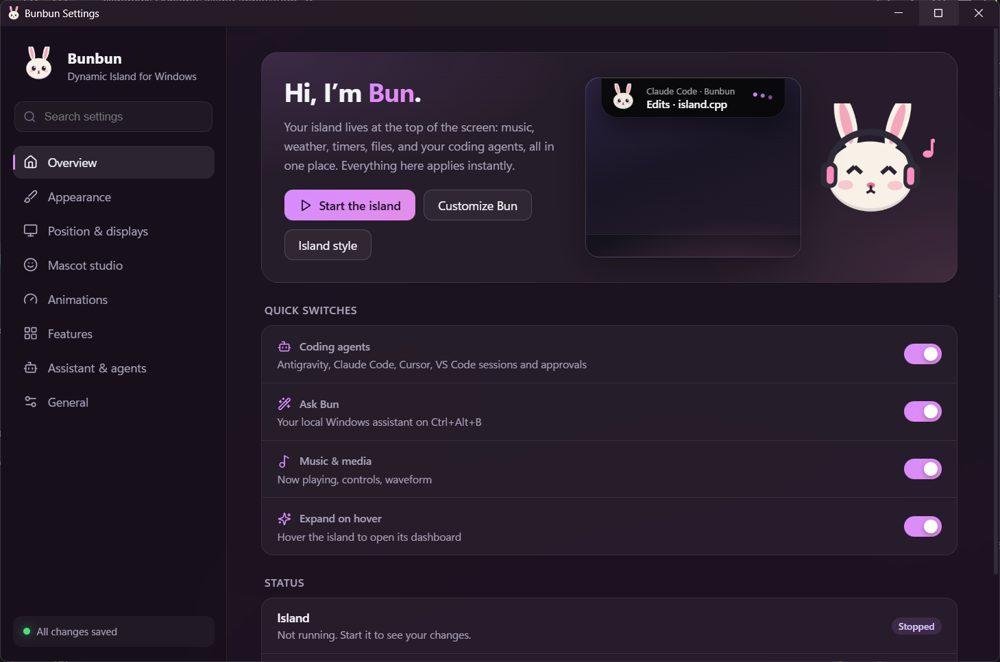
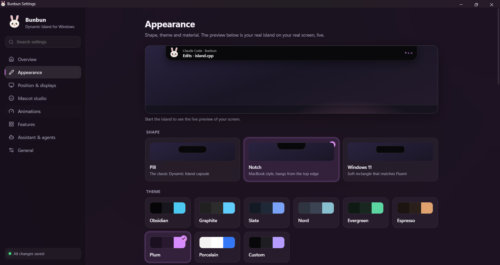
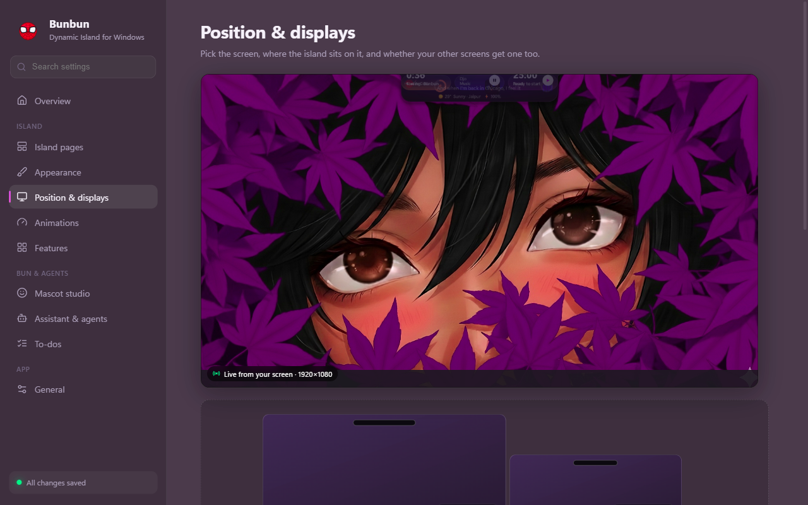
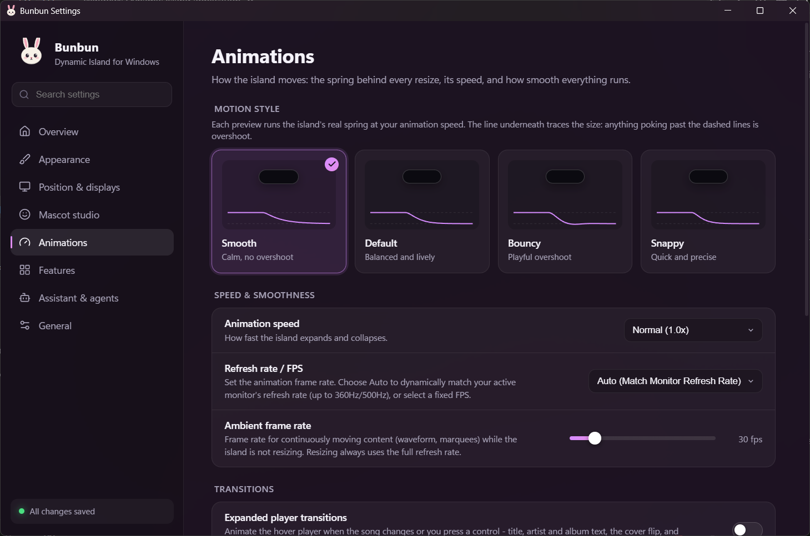
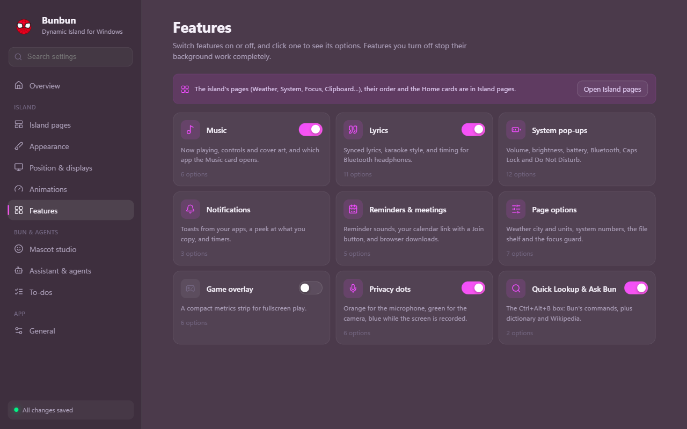

<div align="center">


# Bunbun

**A native Dynamic Island for Windows, with a small bunny named Bun who keeps an eye on your coding agents.**

[Get started](#get-started) · [Features](#features) · [Settings](#the-settings-app) · [Docs](#documentation)

</div>

---

Bunbun is **one island** at the top of your screen (or the bottom, or on every display). It shows
what's playing, your calendar, weather, system stats, Wi-Fi and Bluetooth, notifications, timers and
a file shelf. When your coding agent is working, Bun shows what it's doing; when the agent needs
permission, you answer with one click. When two things happen at once, they share the island side by
side.

It's C++20, Win32 and Direct2D: no Electron, about **30 MB of memory** and **1–3 % of one core**
while idle.

<p align="center">
  
</p>

## Features

### Coding agents, on the island

- **Live ticker** of what your agent is doing: `Edits · island.cpp`, `Runs · ./build.sh`, `+14 −0`.
- **One-click Allow / Deny** for permission requests, and answers to single questions.
- Works with **Claude Code, Antigravity, Cursor and GitHub Copilot** (VS Code agent mode and CLI).
  Connect each one in a click; Bunbun backs up the agent's config first and only adds its own entries.
- **Fails safe.** If Bunbun is closed or you don't click, the agent asks in its own window exactly as
  it would without Bunbun. Nothing is ever approved for you.

### Bun, your mascot

Six characters, all drawn in code: **Bun** the bunny, **Miso** the cat, **Biscuit** the dog,
**Ember** the fox, **Bao** the panda and **Bolt** the robot. Each has its own colours and reacts to
what's happening:

<p align="center">
  
  <br>
  <sub>Idle · Working · Thinking · Needs you · Celebrate · Music · Do not disturb · Error · Sleepy</sub>
</p>

Bun sits beside the clock, puts on headphones when music plays, hops when a task finishes, and
settles in with a snack when you turn on mascot do-not-disturb. You can also load your own art as a
[skin pack](docs/mascots.md#custom-skin-packs).

### Everything else on the island

| | |
|---|---|
| **Music** | Album art, controls, waveform, synced lyrics, and the song title on the collapsed pill |
| **Dashboards** | Hover to expand, scroll to switch: calendar, weather, hardware monitor (CPU, RAM, GPU, disk, network speed), connectivity (tap Wi-Fi or Bluetooth to toggle, hold it to pick a network or device; battery on laptops), file shelf |
| **System flyouts** | Volume, brightness, battery, Bluetooth devices, Caps Lock |
| **To-dos & reminders** | Ask Bun `add buy milk`, `remind me at 3pm to call Sam` or `remind me every weekday at 9 to stand up`; a To-do tab, a reminder pill with Snooze and Done (quiet in full screen, presentations and meetings), and a To-dos page in Settings to edit and reschedule. Stored on your PC only |
| **Focus mode** | `focus 50`: a timer, the mascot on do-not-disturb, notifications held back, and a summary of what you ticked off |
| **Meetings** | Paste your calendar's private iCal link (Google or Outlook) and the island counts down to your next meeting with a **Join** button |
| **Downloads** | Browser downloads show as they arrive (name, size, speed), then "Downloaded" |
| **Notifications & clipboard** | App toasts and a peek at what you copy |
| **Local AI (optional)** | Turn on a small language model that runs offline on your PC. Bun then answers free-form questions and works like an agent: "get me ready for a meeting" turns on DND, lowers the volume and opens Teams; "is it warmer in Delhi or Mumbai?" looks both up and compares. No account, no keys; you download the model yourself ([guide](docs/local-ai.md)) |
| **Privacy dots** | Orange while the microphone is in use, green for the camera, blue while the screen is recorded, and a short note naming the app ("Discord is using your microphone") |
| **Ask Bun** | Press **Ctrl+Alt+B** and type `open notepad`, `volume 40`, `next song`, `timer 25 min`, `weather`, `12*7`, `dnd on`, `wifi off`, `brightness 60`, `add buy milk`, `remind me in 20 min to stretch`, `undo`… Up arrow recalls earlier commands; Ctrl+Z undoes the last one A local assistant: nothing is sent to any AI service |

## The settings app

Every option has a home, and changes apply to the island the moment you make them.

<table>
  <tr>
    <td width="50%"><br><sub><b>Appearance.</b> Pill, macOS-style notch or Windows 11 shape, themes, and a live preview of your real island on your wallpaper.</sub></td>
    <td width="50%"><br><sub><b>Position & displays.</b> Any screen, or all of them, with its own top or bottom position per display.</sub></td>
  </tr>
  <tr>
    <td width="50%"><br><sub><b>Animations.</b> Four motion styles, each previewed with the island's real spring and an overshoot trace.</sub></td>
    <td width="50%"><br><sub><b>Features.</b> Turn on what you use; disabled features stop their background work completely.</sub></td>
  </tr>
</table>

## Download

Grab **`Bunbun-<version>-setup.exe`** from the [latest release](../../releases/latest) and run it;
that one file is all you need. It installs for your account only (no admin prompt) into `%LOCALAPPDATA%\Programs\Bunbun`, adds
Bunbun to the Start menu, and can:

- start Bunbun when you sign in;
- install the WebView2 Runtime if your Windows doesn't have it (the settings window needs it;
  Windows 11 always does);
- set up [Local AI](docs/local-ai.md) for Ask Bun: tick it and the installer downloads a small
  language model (about 1.1 GB, checked against its published hash) and turns it on. Skip it and
  add a model any time later.

Uninstall from **Settings → Apps**. It quits Bunbun and disconnects the coding agents connected to
it first; your settings, skin packs and models stay in your AppData folders.

It runs on Windows 10 and 11 (x64). The app isn't code-signed yet, so SmartScreen may warn the
first time: choose **More info → Run anyway**. Check the download against `SHA256SUMS.txt` on the
release page if you like.

## Get started

1. **Run it.** Install it (above), or build it yourself (see
   [docs/building.md](docs/building.md)):

   ```bash
   ./scripts/setup.sh
   ```

   ```bash
   ./build.sh
   ```

2. **Find Bun.** Bun appears in the tray and the island at the top of your screen.
3. **Connect your agent** in **Settings → Assistant & agents**, or from the command line:

   ```bash
   build/bunbun.exe --connect claude
   ```

   See [docs/agents.md](docs/agents.md) for Antigravity, Cursor and Copilot.

| Hotkey | Does |
|---|---|
| Ctrl+Alt+B | Opens Ask Bun |
| Ctrl+Alt+D | Hides or shows the island |

Hover the island to expand it, scroll to step through activities and dashboards, and right-click it
for quick options. Settings live in `%APPDATA%\Bunbun\settings.ini`.

## Documentation

| Doc | What's in it |
|---|---|
| [Building](docs/building.md) | Toolchain, building, tests, the live dev loop |
| [Coding agents](docs/agents.md) | Connecting agents, how approvals work, troubleshooting |
| [Mascots](docs/mascots.md) | Characters, moods, custom skin packs |
| [Local AI](docs/local-ai.md) | Optional offline AI for Ask Bun: what to download, setup, how it works |
| [Architecture](docs/architecture.md) | How the pieces fit, source layout, security model |
| [Contributing](CONTRIBUTING.md) | Code style, where to add things, project rules |
| [Security](SECURITY.md) | Reporting vulnerabilities |
| [Changelog](CHANGELOG.md) | What changed in each version |

## Privacy

No telemetry and no AI service. The optional local AI runs entirely on your PC. The network is used only by the weather, lyrics and dictionary
modules (and weather for a city you ask about), by the calendar link you add (fetched every 5 minutes), by web searches you ask Bun for, and by a once-a-day update check that asks GitHub for the
latest release (turn it off in **Settings → General → Updates**). Agent hooks talk to the island
over a local pipe that only your user account can open.

## Updates

Bunbun checks GitHub once a day and shows a notification when a new version is out; click it, or
**Update available** in the tray menu, to open the release page. You can also check any time from
the tray (**Check for updates…**) or **Settings → General → Updates**. Nothing is downloaded or
installed for you: run the new setup, which replaces the old version in place. Your settings and
connected agents carry over.

## Credits & license

Bunbun builds on open-source work; see [THIRD_PARTY_NOTICES.md](THIRD_PARTY_NOTICES.md).
Released under the [MIT License](LICENSE).
